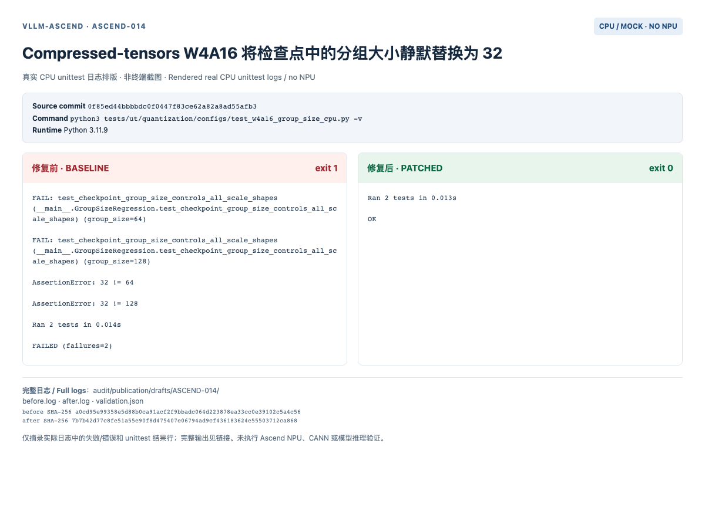

# ASCEND-014: CPU regression evidence

Base: `0f85ed44bbbbdc0f0447f83ce62a82a8ad55afb3`. Python 3.11.9, macOS CPU. No NPU, ACL runtime, serving E2E, or hardware benchmark was run.

The image renders real captured unittest output; it is not an NPU execution screenshot. Read [before.log](before.log) and [after.log](after.log) for full output, and [validation.json](validation.json) for the boundaries of the mocks.

Copy [repro.py](repro.py) into a checkout of the base commit as `tests/ut/quantization/configs/test_w4a16_group_size_cpu.py`. The file must use that repository-relative location so its source loader resolves the production file.

```bash
python3 tests/ut/quantization/configs/test_w4a16_group_size_cpu.py -v
# Expected nonzero exit on the unmodified base.
git apply /path/to/downloaded/fix.patch
python3 tests/ut/quantization/configs/test_w4a16_group_size_cpu.py -v
# Expected exit 0 with the patch.
```

The [production patch](fix.patch) changes only this finding. The reproduction executes the checked-out source with hardware boundaries mocked; frozen upstream fixtures, where present, are explicitly identified in the script. Full repository format output: [format.log](format.log).


