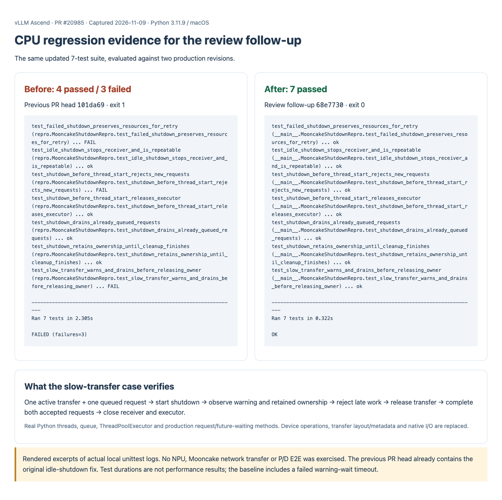

# PR #20985: CPU evidence for the review follow-up

Same updated seven-test suite against two production revisions:

| Revision | Meaning | Result |
| --- | --- | --- |
| `101da698329994eafd62022393dbe9daaacb1548` | Previous PR head; includes the original idle-shutdown fix | 4 passed, 3 failed; exit 1 |
| `68e77300e0fb4b96369edf102a87939df796f57b` | Review follow-up | 7 passed; exit 0 |

Python 3.11.9 on macOS. The test is loaded from the follow-up in both runs. The baseline harness directs its AST source loader to old production files. The `repro.` and `__main__.` prefixes reflect loading methods, not different test methods. See the [test source](https://github.com/vllm-project/vllm-ascend/blob/68e77300e0fb4b96369edf102a87939df796f57b/tests/ut/kv_offload/mooncake_v2/test_pull_worker_shutdown_cpu.py).



## Recorded output and scope

- [Before log](before.log): two missing late-submission rejection assertions and one missing warning assertion fail.
- [After log](after.log): all seven tests pass.
- [Source and evidence hashes](manifest.json).
- [Full repository format output for the source change](format.log).
- Focused test-file mypy outputs: [3.10](mypy-3.10.log), [3.11](mypy-3.11.log), [3.12](mypy-3.12.log). These are target-version checks, not three Python runtime runs.

The image renders captured logs; it is not a terminal or GitHub CI screenshot. Logs retain output with the local checkout directory replaced by `<checkout>` and trailing blank lines normalized. Original local logs were preserved. Test durations do not indicate performance gains: the baseline includes a failed warning-wait timeout.

The slow case uses real Python receiver and shutdown threads, a FIFO queue, `ThreadPoolExecutor`, and production request/future-waiting methods extracted from the checkout. Device operations, transfer layout/metadata and native I/O are replaced. No NPU, network, P/D serving, or hardware performance execution is claimed.

The shutdown warning interval is 30 seconds in production, shortened in the test. Graceful shutdown still waits for accepted transfers. A permanently stuck native call can still prevent shutdown completion.

## Reproduce the comparison

Use a repository clone containing both commits. Create a temporary detached worktree so the existing checkout stays intact. Run the following commands from the clone root; the first Python invocation intentionally exits nonzero.

```bash
REPRO_DIR=$(mktemp -d)
TEST_PATH=tests/ut/kv_offload/mooncake_v2/test_pull_worker_shutdown_cpu.py
SOURCE_PATH=vllm_ascend/distributed/kv_transfer/kv_p2p/mooncake/pull_worker.py
git worktree add --detach "$REPRO_DIR/before" 101da698329994eafd62022393dbe9daaacb1548
git show 68e77300e0fb4b96369edf102a87939df796f57b:"$TEST_PATH" > "$REPRO_DIR/before/$TEST_PATH"
(cd "$REPRO_DIR/before" && python3 "$TEST_PATH" -v)
# Expected: 7 tests, 3 failures. Do not stop the comparison on this expected failure.
git show 68e77300e0fb4b96369edf102a87939df796f57b:"$SOURCE_PATH" > "$REPRO_DIR/before/$SOURCE_PATH"
(cd "$REPRO_DIR/before" && python3 "$TEST_PATH" -v)
# Expected: 7 tests, OK. Both invocations run the same expanded test file.
```

For the second invocation, changing the pull-worker source is sufficient: the connector and base-worker source files are identical between these two revisions. The first invocation here uses `__main__` instead of the original capture harness's `repro` module prefix; assertions are unchanged.
